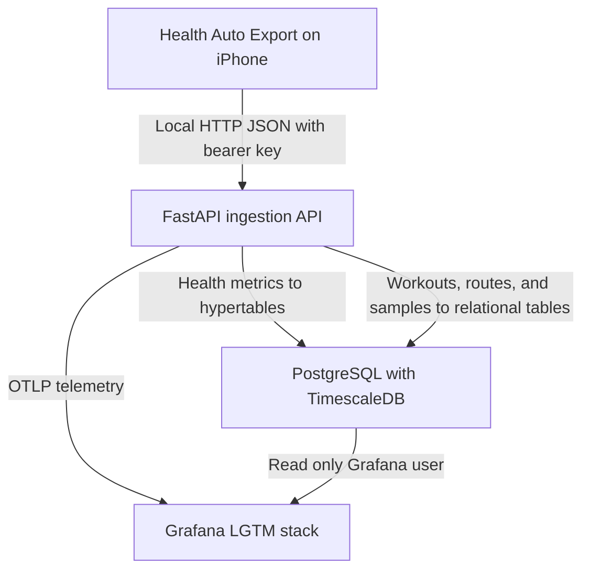
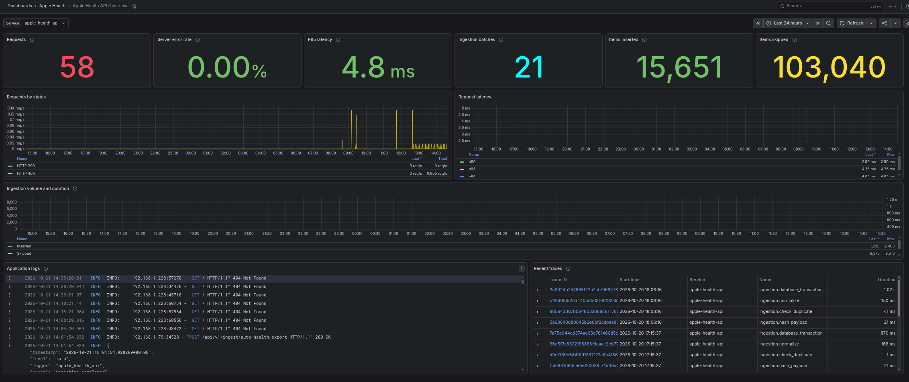
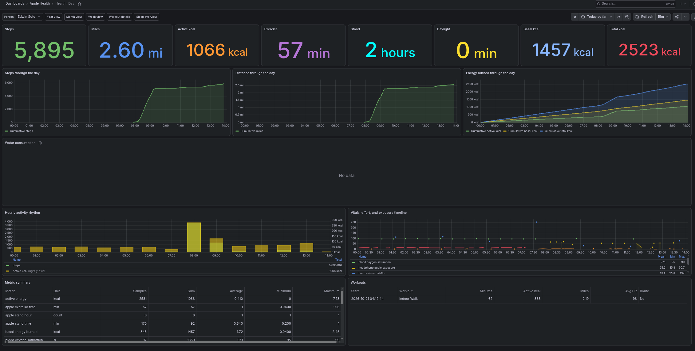
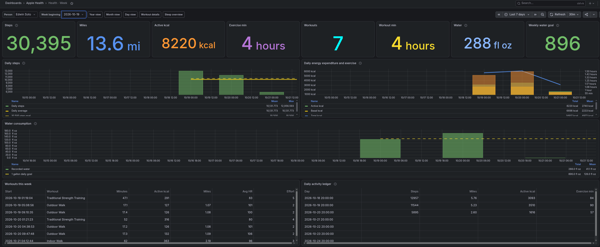
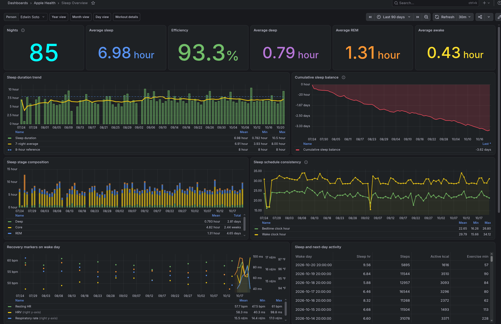
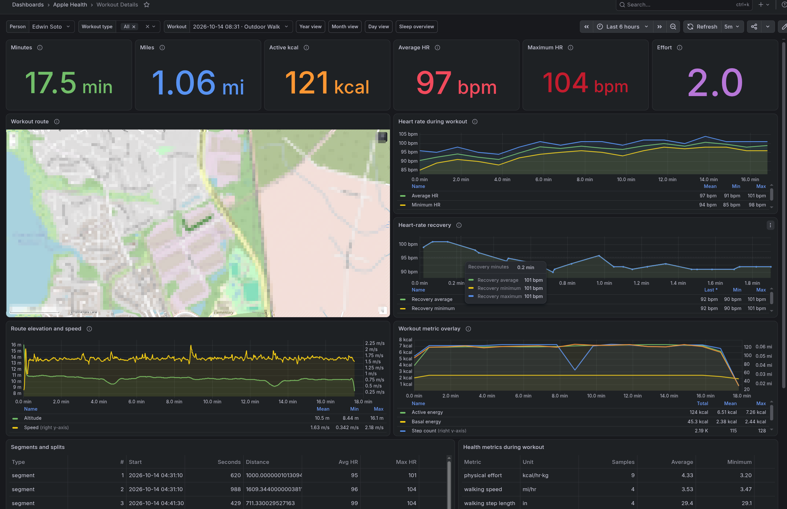

# Apple Health Ingestion API

Local Apple Health ingestion and visualization stack built for
[Health Auto Export](https://help.healthyapps.dev/en/health-auto-export/).
The application accepts JSON health exports, stores time-series data in
PostgreSQL with TimescaleDB, and provisions Grafana dashboards for health,
sleep, workouts, routes, and API observability.

## Features

- FastAPI ingestion endpoints protected with per-user bearer keys.
- Health metric normalization with bounded PostgreSQL writes.
- Idempotent workout imports keyed by user, source, and source workout ID.
- Workout routes, heart-rate/recovery samples, segments, and splits.
- Original request retention and whole-payload duplicate detection.
- PostgreSQL/TimescaleDB health storage and a read-only Grafana role.
- Grafana dashboards for year, month, day, sleep, and workout details.
- Structured application logs plus OpenTelemetry metrics and traces.
- A self-contained Docker Compose stack with Grafana LGTM.

## Architecture



## Project structure

```text
app/
├── api/
│   ├── dependencies.py       # Shared HTTP authentication dependencies
│   └── routes/
│       ├── admin.py          # User and API-key administration
│       ├── health_data.py    # Authenticated metric/workout reads
│       ├── ingestion.py      # Metric, workout, and export ingestion
│       └── system.py         # Service health endpoint
├── core/
│   ├── config.py             # Environment configuration
│   └── observability.py      # Logs, metrics, and traces
├── database/
│   ├── models.py             # PostgreSQL/Timescale ORM models
│   └── session.py            # SQLAlchemy engine and sessions
├── domain/
│   └── schemas.py            # Inbound domain schemas
├── security/
│   └── auth.py               # Per-user bearer-key authentication
├── services/
│   ├── normalizer.py         # Health Auto Export normalization
│   └── persistence.py        # Batched metric/workout persistence
└── main.py                   # Application factory and router assembly

db/init/                      # New-database bootstrap schema
grafana/dashboards/           # Versioned dashboard JSON
grafana/provisioning/         # Datasource and dashboard provisioning
migrations/                   # Manual/legacy migration material
tests/                        # Unit and application contract tests
```

## Requirements

- Docker Engine with Docker Compose.
- An iPhone with Apple Health data and Health Auto Export.
- Both devices connected to the same trusted local network for iPhone testing.

## Configuration

Create the local environment file:

```bash
cp .env.example .env
```

At minimum, replace these values with different, strong secrets:

```text
POSTGRES_PASSWORD
GRAFANA_DB_PASSWORD
GRAFANA_ADMIN_PASSWORD
ADMIN_API_TOKEN
```

`ADMIN_API_TOKEN` must contain at least 32 characters. Ensure the password in
`DATABASE_URL` is identical to `POSTGRES_PASSWORD`. Keep `.env` private and do
not paste the output of `docker compose config` into tickets or logs because it
expands environment secrets.

The default host bindings are intentionally local-only:

```text
API_BIND=127.0.0.1
GRAFANA_BIND=127.0.0.1
```

## Start the stack

```bash
docker compose up -d --build
docker compose ps
curl --fail http://127.0.0.1:8000/health
```

Expected health response:

```json
{"status":"ok"}
```

Grafana is available at `http://127.0.0.1:3000`. Sign in with
`GRAFANA_ADMIN_USER` and `GRAFANA_ADMIN_PASSWORD`.

Useful commands:

```bash
docker compose logs --follow api
docker compose logs --follow lgtm
docker compose ps
docker compose up -d --build api
```

## Create a user API key

`ADMIN_API_TOKEN` is only for administration. Health Auto Export should use a
generated user API key, not the administrator token.

```bash
export ADMIN_API_TOKEN='your-administrator-token'

curl --fail-with-body \
  --request POST \
  http://127.0.0.1:8000/api/v1/admin/api-keys \
  --header "Authorization: Bearer ${ADMIN_API_TOKEN}" \
  --header 'Content-Type: application/json' \
  --data '{
    "name": "Your Name",
    "email": "you@example.com",
    "key_name": "iPhone Health Auto Export"
  }'
```

The response contains `api_key` once. Store it securely. Only its SHA-256 hash
is retained in PostgreSQL.

## Configure Health Auto Export

Create two **REST API** automations: one for workouts and one for health
metrics. Both automations use these shared settings:

```text
Method:         POST
Format:         JSON
Export version: Version 2
URL:            http://YOUR_COMPUTER_LAN_IP:8000/api/v1/ingest/auto-health-export
```

Replace `YOUR_COMPUTER_LAN_IP` with the address described in
[Test from an iPhone on the local network](#test-from-an-iphone-on-the-local-network).

Add the generated user key as an HTTP header:

```text
Key:   Authorization
Value: Bearer YOUR_USER_API_KEY
```

Do not include a colon in the key. Preserve the space after `Bearer`.
Health Auto Export sets the JSON content type automatically.

### Automation 1: Workouts

Configure the first automation as follows:

```text
Data Type:                Workouts
Include Route Data:       On
Include Workout Metrics:  On
Time Grouping:            Minutes
Batch Requests:           On
```

Including route data allows the workout dashboard to display GPS maps.
Including workout metrics and grouping them by minute provides the detailed
time-series data used by the workout charts.

### Automation 2: Health metrics

Configure the second automation as follows:

```text
Data Type:              Health Metrics
Select Health Metrics:  All selected
Batch Requests:         On
```

Selecting every health metric allows the server to ingest all supported Apple
Health observations. Both automations may use the same schedule, or you can
schedule them independently to reduce the amount of data processed in each
export.

The current sleep normalizer and dashboard expect Health Auto Export's
aggregated sleep object. Keep sleep summarization enabled.

### Historical backfill

You can export older Apple Health information, but historical exports can be
problematic because Health Auto Export may group or aggregate the data. The
result may have less detail than recent raw samples and may appear as daily,
weekly, or monthly values rather than individual readings. Review the
automation's summarization and grouping settings before exporting, use small
date ranges, and verify the results before starting a large backfill.

Avoid sending several years of high-frequency data in one request. FastAPI
must parse and normalize the complete request, and the original JSON is also
retained in `ingestion_batches`.

Recommended process:

1. Test one day with one or two metrics.
2. Confirm `received` and `inserted` are nonzero.
3. Import historical metrics in non-overlapping monthly windows.
4. Shorten unsummarized heart-rate or dense observation exports to weekly
   windows if the phone reports slow queries or memory pressure.
5. Import workouts separately with JSON batching enabled.
6. Work from the oldest window to the newest and record each response batch ID.
7. After backfill, enable scheduled ongoing automations.

A successful response resembles:

```json
{
  "status": "success",
  "batch_id": "...",
  "received": 12500,
  "inserted": 12100,
  "skipped": 400,
  "metrics_inserted": 12080,
  "workouts_inserted": 20
}
```

The endpoint recognizes identical payloads as duplicate batches. Metrics use a
provided sample ID when available; otherwise identity is derived from the
normalized record. Workouts are upserted, and their routes, samples, and
intervals are replaced atomically on re-import.

### Metric resolution and aggregation

Every health metric is stored with a `raw`, `daily`, `weekly`, or `monthly`
resolution. Explicit export metadata is preferred; additive series with a stable
daily or weekly cadence are classified during normalization. Grafana's detailed
day, week, and month panels use raw samples, while longer-range panels may use a
coarser rollup when detailed data is unavailable. This prevents weekly exports
from being plotted as single-day spikes.

TimescaleDB `time_bucket_gapfill` creates timezone-aware chart buckets. An outer
PostgreSQL window calculation produces cumulative totals from those buckets.
Missing additive buckets remain unknown unless a panel documents a fallback;
they are not interpolated into fabricated measurements.

## Test from an iPhone on the local network

For temporary same-Wi-Fi testing, bind the API to the computer's LAN address:

```text
API_BIND=192.168.1.100
```

Restart the API:

```bash
docker compose up -d api
```

If UFW is enabled, permit only the trusted LAN subnet:

```bash
sudo ufw allow in on wlan0 from 192.168.1.0/24 to 192.168.1.100 port 8000 proto tcp
```

Open this URL in Safari first:

```text
http://192.168.1.100:8000/health
```

Then configure Health Auto Export with:

```text
http://192.168.1.100:8000/api/v1/ingest/auto-health-export
```

Both devices must use the same non-guest Wi-Fi. Disable VPN temporarily if it
intercepts local traffic, and grant Health Auto Export access under **iPhone
Settings → Privacy & Security → Local Network**. Restore `API_BIND=127.0.0.1`
after testing if LAN access is no longer required.

HTTP is suitable only for a trusted local test. Use HTTPS for normal operation.

## Manual JSON upload

```bash
export API_TOKEN='your-user-api-key'

curl --fail-with-body \
  --request POST \
  http://127.0.0.1:8000/api/v1/ingest/auto-health-export \
  --header "Authorization: Bearer ${API_TOKEN}" \
  --header 'Content-Type: application/json' \
  --data-binary @health-export.json
```

## API reference

Interactive OpenAPI documentation is available at `/docs` while the API is
running.

| Method | Path | Authentication | Purpose |
|---|---|---|---|
| GET | `/health` | None | Container and reverse-proxy health check |
| POST | `/api/v1/admin/api-keys` | Administrator bearer token | Create a user and one-time API key |
| POST | `/api/v1/ingest/auto-health-export` | User bearer key | Normalize a Health Auto Export JSON payload |
| POST | `/api/v1/ingest/metrics` | User bearer key | Insert normalized metric objects |
| POST | `/api/v1/ingest/workouts` | User bearer key | Upsert normalized workout objects |
| GET | `/api/v1/metrics` | User bearer key | Return recent metrics; `limit` is clamped to 1–10,000 |
| GET | `/api/v1/workouts` | User bearer key | Return recent workouts; `limit` is clamped to 1–10,000 |
| GET | `/api/v1/workouts/{workout_id}` | User bearer key | Return one user-owned workout |

## Data model

| Relation | Contents |
|---|---|
| `users` | User identity and data ownership |
| `api_keys` | Hashed per-user bearer keys and revocation state |
| `ingestion_batches` | Payload hashes, processing counts, and original JSON |
| `health_metrics` | Timescale hypertable containing metric samples |
| `workouts` | Workout identity and summary fields |
| `workout_routes` | Ordered GPS coordinates and route telemetry |
| `workout_samples` | Workout and recovery time-series samples |
| `workout_intervals` | Workout segments and distance splits |
| `daily_metric_summary` | Daily metric aggregates |
| `daily_workout_summary` | Daily workout aggregates |

Health metric writes are internally split into batches of 500. Workout child
rows are written in batches of 1,000.

## Grafana dashboards

The Compose stack uses `grafana/otel-lgtm`, containing Grafana, Loki, Tempo,
Mimir, and an OpenTelemetry collector. Dashboard JSON is mounted read-only and
reloaded every ten seconds.

The **Apple Health** folder includes:

- **Apple Health API Overview** — selected-range HTTP and ingestion totals,
  errors, latency, ingestion duration, deduplicated logs, and recent traces.
- **Health · Year** — eight yearly summary cards including active, basal, and
  total energy, cumulative daily progress, monthly hydration, trends, vitals,
  and workout volume.
- **Health · Month** — eight calendar-month summary cards including active,
  basal, and total energy, daily consistency, cumulative activity and
  hydration with a 128 fl oz daily goal line, walking quality, and workout
  history.
- **Health · Week** — Monday-through-Sunday summary cards, daily-resolution
  steps and energy, hydration against a one-gallon daily goal, workouts, and a
  daily activity ledger. Use the **Week beginning** selector to move between
  weeks.
- **Health · Day** — eight daily summary cards including active, basal, and
  total energy, intraday cumulative activity and water consumption, hourly
  movement, readings, and workouts. Select an
  absolute range from local midnight to the following midnight with Grafana's
  time picker.
- **Sleep Overview** — six summary cards, sleep by local wake date, stages,
  efficiency, schedule consistency, cumulative sleep balance, recovery, and
  next-day activity.
- **Workout Details** — six summary cards, GPS route, heart rate, recovery,
  elevation, speed, workout metrics, splits, and related observations. Workout
  charts use elapsed minutes and therefore do not depend on Grafana's global
  time range. The map fits to the selected workout route with a maximum zoom of
  15. Route-aware outdoor activities, such as walking or cycling, display a map
  when Health Auto Export includes route data. If the selected workout has no
  route, the map does not populate.

### Dashboard screenshots

Click a screenshot to open the full-size image.

| Apple Health API Overview | Health · Day |
|---|---|
| [](docs/images/api-overview.png) | [](docs/images/health-day.png) |
| **Health · Week** | **Sleep Overview** |
| [](docs/images/health-week.png) | [](docs/images/sleep.png) |

#### Workout Details

[](docs/images/workout-details.png)

Outdoor workouts display their recorded route when route
data is present in the Health Auto Export payload. Indoor workouts and exports
without route data leave the map empty; the remaining workout panels that do not rely on location data will still populate when their corresponding metrics are available.


```bash
### PostgreSQL datasource

Provisioning creates a datasource with:

```text
Name: Apple Health PostgreSQL
UID:  apple-health-postgres
Host: timescaledb:5432
User: grafana_reader
```

The health dashboards refer to the fixed UID `apple-health-postgres`.

## Logs, metrics, and traces

Application logs are structured JSON and include `trace_id` and `span_id`.
Ingestion logging records counts, byte sizes, timings, and outcomes without
logging metric values, source/device names, workout names, GPS coordinates, or
raw request bodies. Ingestion events also include `user_id`, `user_name`, and
an explicit `upload_type` (`metrics`, `workouts`, `mixed`, or `empty`) after
payload normalization. Early events for the generic Auto Health Export route
use `unclassified` until its contents have been inspected. User email addresses,
API keys, and API-key hashes are never logged.

Compose sends OTLP/HTTP to the private endpoint:

```text
http://lgtm:4318
```

The API creates spans for request handling, payload hashing, duplicate checks,
normalization, metric writes, workout writes, and transaction commits. OTLP
port 4318 is intentionally not published to the host.

## Database initialization and migrations

Files under `db/init/` execute only when PostgreSQL initializes an empty data
volume. They do not run again when containers restart.

There is currently no automatic migration runner. Treat files under
`migrations/` as manual/legacy material: back up an existing database and
review schema differences before applying SQL. Do not assume the new-database
bootstrap can be safely replayed over an older deployment.

Existing deployments created before metric resolution was introduced should
apply the idempotent resolution migration after taking a backup:

```bash
docker cp migrations/003_metric_resolution.sql \
  apple-health-db:/tmp/003_metric_resolution.sql
docker compose exec -T timescaledb \
  psql -U health_app -d health -v ON_ERROR_STOP=1 \
  -f /tmp/003_metric_resolution.sql
```

## Backup and restore

Create a logical backup before schema or deployment changes:

```bash
docker compose exec -T timescaledb \
  sh -lc 'pg_dump -U "$POSTGRES_USER" -d "$POSTGRES_DB" --format=custom' \
  > apple-health.dump
```

Keep copies of original Health Auto Export files until imported counts and
dashboards have been verified. Although request payloads are retained in the
database, source files provide an independent recovery path.

The named volumes are persistent. Do not run `docker compose down -v` unless
you intend to delete PostgreSQL and LGTM data.

## Acknowledgements

This application was built to expand on the work of the original
[HealthyApps/health-auto-export-server](https://github.com/HealthyApps/health-auto-export-server)
project. Thank you to its maintainers and contributors for providing the
foundation and inspiration for this implementation.

The original project's
[Step 3: iPhone Setup](https://github.com/HealthyApps/health-auto-export-server#step-3-iphone-setup)
is also a useful walkthrough of creating a Health Auto Export automation on an
iPhone. Its server URL and authentication header differ from this application,
so use the endpoint and bearer-key settings documented in
[Configure Health Auto Export](#configure-health-auto-export) above.
